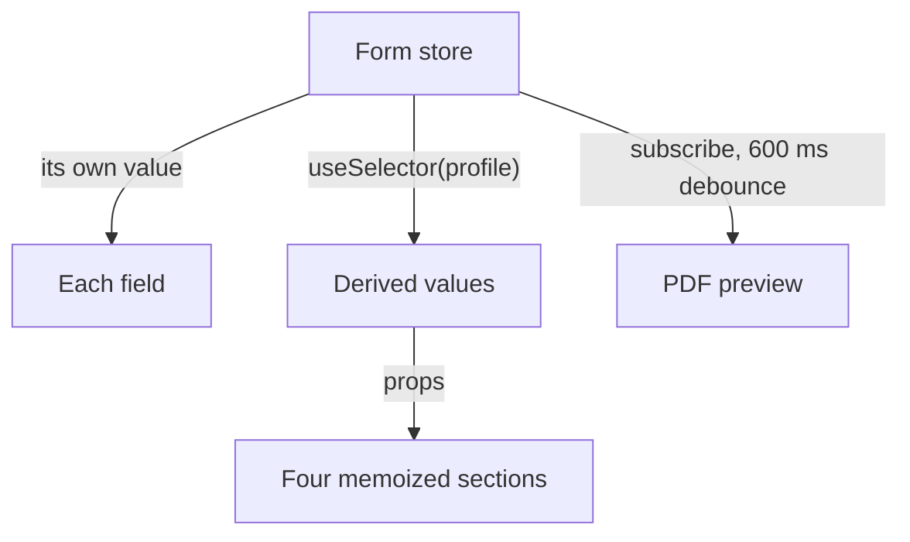

import { isBlogPostPublished } from "@web/lib/blog-publication";

I built a form with about 90 fields in eight accordion sections and a PDF preview beside it that follows every edit. Some sections also show derived values computed from the form.

A live preview pushes a long form toward the worst shape. The preview needs every value, so the obvious home for the values is a parent of the form and the preview, and then every keystroke re-renders the whole form. TanStack Form avoids that because the values never live in React state. The code samples use a simplified profile form with the same wiring.

## Values live in a store

`useAppForm` creates a form whose values sit in a TanStack Store, outside React. Typing into a field calls `field.handleChange`, which writes the new value at that field's path. The write copies only the objects along that path, so every other object keeps its identity.

Each field gets its own small store, derived from the form store, which returns the previous object when the field's value and meta didn't change. The field component reads it through `useSelector`, which compares with `===`. A keystroke re-renders the edited field and any component that selected an object on the edited path. The [reactivity guide](https://tanstack.com/form/latest/docs/framework/react/guides/reactivity) gives the same rule. A component re-renders for what it selects with `useSelector`, and `form.Subscribe` re-renders only its children.

## One registered component per kind of input

[`createFormHook`](https://tanstack.com/form/latest/docs/framework/react/guides/form-composition) registers the field components once, and each section is a `withForm` component that receives a typed `form`:

```tsx
export const { useAppForm, withForm } = createFormHook({
  fieldContext,
  formContext,
  fieldComponents: { TextField, NumberField, SelectField, ToggleField },
  formComponents: {},
});

export const ProfileSection = withForm({
  ...formOptions({ defaultValues }),
  props: { summary: EMPTY_SUMMARY },
  render: function Render({ form, summary }) {
    return (
      <>
        <form.AppField name="profile.name">
          {(field) => <field.TextField label="Name" />}
        </form.AppField>
        <p>{summary.text}</p>
      </>
    );
  },
});
```

Each field component, like `TextField`, calls `useFieldContext`, renders a label and a control, and wires up `handleChange` and `handleBlur`. TypeScript checks `name` against the form values, nested paths included. The default values give the section its value types, and `props` declares extra props with their defaults, here the derived `summary`.

`SelectField` and `ToggleField` are generic over their options, so the value type flows from a `readonly` list, like a Zod enum's `.options`, to the field. The field type has one limit. `useFieldContext<number | "">()` takes its type argument on trust, so `field.NumberField` under a text path compiles.

## Sections select only what they show

A section re-renders when its props change or when a value it selected changes. Two sections select one value each, `settings.unit` for some placeholders and `settings.mode` for which inputs appear. The other six select nothing.

The derived values read most of the data, so the form component computes them once and passes them down as props:

```tsx
const profile = useSelector(form.store, (state) => state.values.profile);
const stats = useMemo(() => computeStats(profile), [profile]);
const summary = useMemo(() => buildSummary(stats), [stats]);
```

Report-only values like notes, photos and text overrides sit beside `profile` under `report`, so editing a note leaves `profile` with the same identity and neither `useMemo` runs. Each section is wrapped in `memo` and gets the same `form` object on every render. Typing under `profile` produces new `stats` and `summary` objects, so the four sections that receive them re-render. The other four don't.

I counted rendered components with a React DevTools hook in a dev build. A keystroke outside `profile` re-renders 6 components: the field, its label and their wrappers. A keystroke under `profile` re-renders 62 with a light section open, because closed accordion sections don't mount their fields. With the heaviest section open, 18 rows of generated text with tooltips, it re-renders 595.

## The preview reads the store after a pause

The preview doesn't use `useSelector`. The route subscribes to the store in an effect and copies the values 600 ms after the last change:

```tsx
useEffect(() => {
  let timeout: ReturnType<typeof setTimeout> | undefined;
  const { unsubscribe } = form.store.subscribe(() => {
    clearTimeout(timeout);
    timeout = setTimeout(() => setPreviewValues(form.state.values), 600);
  });
  return () => {
    clearTimeout(timeout);
    unsubscribe();
  };
}, [form]);
```

`previewValues` is route state that the preview reads from a context, so setting it re-renders the route's layout. The form component is wrapped in `memo` and its props don't change, so a preview update re-renders no fields. It re-renders 268 components, all in the preview's toolbar and pages. A Web Worker then builds the PDF from the snapshot, off the thread that handles the inputs.

{isBlogPostPublished(new Date("2026-11-21")) && (

  <p>
    The next post, <a href="/blog/pdf-preview-in-a-web-worker">A live PDF preview off the main thread</a>, covers that worker.
  </p>
)}



## Where the other libraries fit

I like the TanStack libraries, so I came in biased. I still had four reasons to pick TanStack Form: typed nested paths, updates scoped to the field, typed field components registered through `createFormHook` and `withForm`, and an app that already runs on TanStack Start and Router.

I didn't build this form in four libraries. To check the choice, the table maps each one onto it, using the docs and npm as of November 2026.

<div className="typeset-scroll typeset-scroll--wrap">

|                  | TanStack Form 1.33                                                                             | React Hook Form 7.91                                                                                                       | Formik 2.4                                                                         | Conform 1.21                                                                                                         |
| ---------------- | ---------------------------------------------------------------------------------------------- | -------------------------------------------------------------------------------------------------------------------------- | ---------------------------------------------------------------------------------- | -------------------------------------------------------------------------------------------------------------------- |
| What re-renders  | Each field for its own value                                                                   | Uncontrolled native inputs; [`subscribe`](https://react-hook-form.com/docs/useform/subscribe) listens without re-rendering | Every plain `Field`; [`FastField`](https://formik.org/docs/api/fastfield) opts out | An experimental [`useFormData`](https://conform.guide/api/react/future/useFormData) selector when its result changes |
| Field names      | Checked                                                                                        | [`FieldPath`](https://react-hook-form.com/docs/usecontroller)                                                              | [`string`](https://formik.org/docs/api/field)                                      | [Inferred](https://conform.guide/) `fields` object                                                                   |
| Custom controls  | Registered on `createFormHook`                                                                 | `useController` per control                                                                                                | `useField` per control                                                             | [`useInputControl`](https://conform.guide/api/react/useInputControl) per control                                     |
| Size, min + gzip | [17.9 kB](https://bundlephobia.com/package/@tanstack/react-form@1.33.5)                        | [16.0 kB](https://bundlephobia.com/package/react-hook-form@7.91.0)                                                         | [13.1 kB](https://bundlephobia.com/package/formik@2.4.9)                           | [10.4 kB](https://bundlephobia.com/package/@conform-to/react@1.21.3)                                                 |
| Latest stable    | [Aug 2026](https://www.npmjs.com/package/@tanstack/react-form?activeTab=versions), v2 in alpha | Oct 2026, [v8 in beta](https://github.com/react-hook-form/react-hook-form/releases)                                        | [Nov 2025](https://www.npmjs.com/package/formik?activeTab=versions)                | [Oct 2026](https://www.npmjs.com/package/@conform-to/react?activeTab=versions)                                       |

</div>

React Hook Form is simpler on a form of mostly native inputs, because `register` needs no render prop per field. Here 43 of the 86 `form.AppField` fields are toggle groups, styled checkboxes, photo uploads and editors for lists of generated text, and each would need `useController`, which cancels most of that advantage. Conform fits a form that has to [progressively enhance a plain HTML form](https://conform.guide/) posted to the server. Formik still works for a short form, but its plain string names and a last release in November 2025 rule it out for me.
