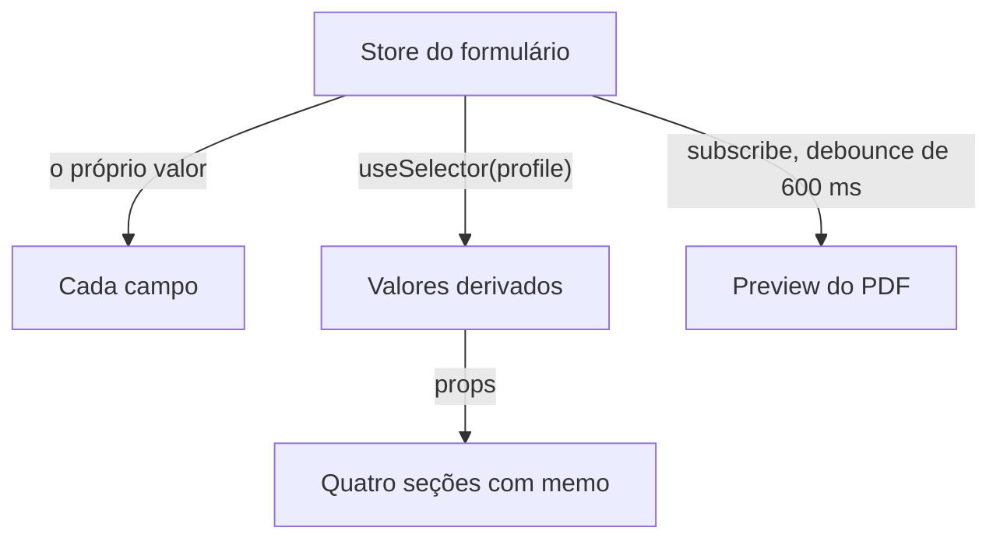

import { isBlogPostPublished } from "@web/lib/blog-publication";

Construí um formulário com cerca de 90 campos, divididos em oito seções de um accordion, e um preview de PDF ao lado que acompanha cada edição. Algumas seções também mostram valores derivados, calculados a partir do formulário.

Um preview ao vivo empurra um formulário longo para a pior estrutura. O preview precisa de todos os valores, então o lugar óbvio para eles é um componente pai comum ao formulário e ao preview, e aí cada tecla digitada re-renderiza o formulário inteiro. O TanStack Form evita isso porque os valores nunca ficam no estado do React. Os exemplos de código usam um formulário de perfil simplificado, com a mesma estrutura.

## Os valores ficam num store

O `useAppForm` cria um formulário cujos valores ficam num TanStack Store, fora do React. Digitar num campo chama `field.handleChange`, que grava o novo valor no caminho daquele campo. A gravação copia só os objetos ao longo desse caminho, então todos os outros objetos mantêm a mesma identidade.

Cada campo ganha um store próprio e pequeno, derivado do store do formulário, que devolve o objeto anterior quando o valor e os metadados do campo não mudaram. O componente do campo lê esse store pelo `useSelector`, que compara com `===`. Uma tecla digitada re-renderiza o campo editado e qualquer componente que tenha selecionado um objeto no caminho editado. O [guia de reatividade](https://tanstack.com/form/latest/docs/framework/react/guides/reactivity) descreve a mesma regra. Um componente re-renderiza por causa do que seleciona com `useSelector`, e o `form.Subscribe` re-renderiza só os próprios filhos.

## Um componente registrado para cada tipo de input

O [`createFormHook`](https://tanstack.com/form/latest/docs/framework/react/guides/form-composition) registra os componentes de campo uma única vez, e cada seção é um componente `withForm` que recebe um `form` tipado:

```tsx
export const { useAppForm, withForm } = createFormHook({
  fieldContext,
  formContext,
  fieldComponents: { TextField, NumberField, SelectField, ToggleField },
  formComponents: {},
});

export const ProfileSection = withForm({
  ...formOptions({ defaultValues }),
  props: { summary: EMPTY_SUMMARY },
  render: function Render({ form, summary }) {
    return (
      <>
        <form.AppField name="profile.name">
          {(field) => <field.TextField label="Name" />}
        </form.AppField>
        <p>{summary.text}</p>
      </>
    );
  },
});
```

Cada componente de campo, como o `TextField`, chama `useFieldContext`, renderiza um rótulo e um controle e conecta `handleChange` e `handleBlur`. O TypeScript valida `name` com base nos valores do formulário, incluindo caminhos aninhados. Os valores padrão dão à seção os tipos dos valores, e o `props` declara props extras com seus valores padrão, aqui o `summary` derivado.

O `SelectField` e o `ToggleField` são genéricos no tipo das opções, então o tipo do valor sai de uma lista `readonly`, como o `.options` de um enum do Zod, e chega até o campo. O tipo do campo tem um limite. O `useFieldContext<number | "">()` aceita o argumento de tipo na confiança, então um `field.NumberField` num caminho de texto compila.

## As seções selecionam só o que mostram

Uma seção re-renderiza quando suas props mudam ou quando muda um valor que ela selecionou. Duas seções selecionam um valor cada: `settings.unit`, para alguns placeholders, e `settings.mode`, para decidir quais campos aparecem. As outras seis não selecionam nada.

Os valores derivados leem quase todos os dados, então o componente do formulário calcula esses valores uma vez e os repassa como props:

```tsx
const profile = useSelector(form.store, (state) => state.values.profile);
const stats = useMemo(() => computeStats(profile), [profile]);
const summary = useMemo(() => buildSummary(stats), [stats]);
```

Os valores que só servem ao relatório, como notas, fotos e textos sobrescritos, ficam ao lado de `profile`, em `report`. Por isso, editar uma nota mantém a identidade do `profile` e nenhum dos dois `useMemo` roda. Cada seção fica dentro de um `memo` e recebe o mesmo objeto `form` em toda renderização. Digitar num campo de `profile` gera objetos `stats` e `summary` novos, então as quatro seções que os recebem re-renderizam. As outras quatro não.

Contei os componentes renderizados com um hook do React DevTools num build de desenvolvimento. Uma tecla digitada fora de `profile` re-renderiza 6 componentes: o campo, o rótulo e os wrappers dos dois. Uma tecla digitada num campo de `profile` re-renderiza 62 com uma seção leve aberta, porque as seções fechadas do accordion não montam seus campos. Com a seção mais pesada aberta, que tem 18 linhas de texto gerado com tooltips, ela re-renderiza 595.

## O preview lê o store depois de uma pausa

O preview não usa `useSelector`. A rota assina o store num efeito e copia os valores 600 ms depois da última mudança:

```tsx
useEffect(() => {
  let timeout: ReturnType<typeof setTimeout> | undefined;
  const { unsubscribe } = form.store.subscribe(() => {
    clearTimeout(timeout);
    timeout = setTimeout(() => setPreviewValues(form.state.values), 600);
  });
  return () => {
    clearTimeout(timeout);
    unsubscribe();
  };
}, [form]);
```

O `previewValues` é estado da rota, e o preview lê esse valor de um contexto, então atualizá-lo re-renderiza o layout da rota. O componente do formulário fica dentro de um `memo` e as props dele não mudam, então uma atualização do preview não re-renderiza nenhum campo. Ela re-renderiza 268 componentes, todos na barra de ferramentas e nas páginas do preview. Depois, um Web Worker gera o PDF a partir do snapshot, fora da thread que cuida dos campos.

{isBlogPostPublished(new Date("2026-11-21")) && (

  <p>
    O próximo post, <a href="/pt-BR/blog/pdf-preview-in-a-web-worker">Um preview de PDF ao vivo fora da thread principal</a>, trata desse worker.
  </p>
)}



## Onde as outras bibliotecas se encaixam

Gosto das bibliotecas do TanStack, então já comecei com um viés. Mesmo assim, tive quatro motivos para escolher o TanStack Form: caminhos aninhados tipados, atualizações restritas ao campo, componentes de campo tipados registrados com `createFormHook` e `withForm`, e um app que já roda em TanStack Start e Router.

Não construí este formulário em quatro bibliotecas. Para conferir a escolha, a tabela mostra como cada uma se aplicaria a ele, com base na documentação e no npm em novembro de 2026.

<div className="typeset-scroll typeset-scroll--wrap">

|                        | TanStack Form 1.33                                                                              | React Hook Form 7.91                                                                                                       | Formik 2.4                                                                            | Conform 1.21                                                                                                            |
| ---------------------- | ----------------------------------------------------------------------------------------------- | -------------------------------------------------------------------------------------------------------------------------- | ------------------------------------------------------------------------------------- | ----------------------------------------------------------------------------------------------------------------------- |
| O que re-renderiza     | Cada campo, pelo próprio valor                                                                  | Inputs nativos não controlados; [`subscribe`](https://react-hook-form.com/docs/useform/subscribe) escuta sem re-renderizar | Todo `Field` comum; [`FastField`](https://formik.org/docs/api/fastfield) fica de fora | Um seletor experimental do [`useFormData`](https://conform.guide/api/react/future/useFormData), quando o resultado muda |
| Nomes de campo         | Verificados                                                                                     | [`FieldPath`](https://react-hook-form.com/docs/usecontroller)                                                              | [`string`](https://formik.org/docs/api/field)                                         | Objeto `fields` [inferido](https://conform.guide/)                                                                      |
| Controles customizados | Registrados no `createFormHook`                                                                 | `useController` por controle                                                                                               | `useField` por controle                                                               | [`useInputControl`](https://conform.guide/api/react/useInputControl) por controle                                       |
| Tamanho, min + gzip    | [17,9 kB](https://bundlephobia.com/package/@tanstack/react-form@1.33.5)                         | [16,0 kB](https://bundlephobia.com/package/react-hook-form@7.91.0)                                                         | [13,1 kB](https://bundlephobia.com/package/formik@2.4.9)                              | [10,4 kB](https://bundlephobia.com/package/@conform-to/react@1.21.3)                                                    |
| Última versão estável  | [Ago. 2026](https://www.npmjs.com/package/@tanstack/react-form?activeTab=versions), v2 em alpha | Out. 2026, [v8 em beta](https://github.com/react-hook-form/react-hook-form/releases)                                       | [Nov. 2025](https://www.npmjs.com/package/formik?activeTab=versions)                  | [Out. 2026](https://www.npmjs.com/package/@conform-to/react?activeTab=versions)                                         |

</div>

O React Hook Form é mais simples num formulário feito quase todo de inputs nativos, porque o `register` dispensa render prop por campo. Aqui, 43 dos 86 campos de `form.AppField` são grupos de toggle, checkboxes estilizados, uploads de foto e editores de listas de texto gerado, e cada um precisaria de `useController`, o que anula boa parte dessa vantagem. O Conform faz sentido quando é preciso [aplicar progressive enhancement a um formulário HTML simples](https://conform.guide/) enviado ao servidor. O Formik ainda funciona num formulário curto, mas os nomes de campo como string pura e a última versão em novembro de 2025 o tiram da minha lista.
