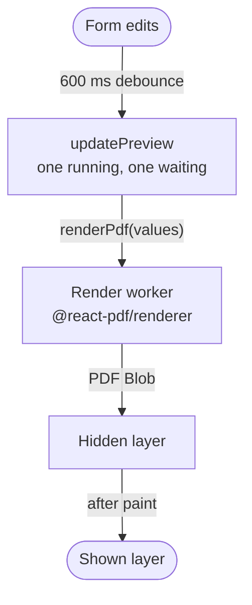

import { isBlogPostPublished } from "@web/lib/blog-publication";

The [previous post](/blog/long-form-live-preview-tanstack-form) covered a long form built on TanStack Form. That form feeds a PDF preview beside it. Every edit re-renders a multi-page report with charts and photos, and the preview has to keep up without making the form slow to type in.

Two libraries with confusing names do the work. `@react-pdf/renderer` turns React components into a PDF file, and `react-pdf` displays that file with pdf.js.



## Why the render needs its own thread

`@react-pdf/renderer` lays out the document and writes the PDF in JavaScript, as one long task. While that task runs on the main thread, the browser can't handle a keystroke or paint the character that was just typed. A preview that re-renders on every edit puts the task exactly where someone is typing.

So the render runs in a module worker. I measured a production build in headless Chrome on an M1 Pro, typing into a text field in eight bursts with a pause after each. The report has two layouts. A render takes about 40 ms in the worker for the simpler layout and about 130 ms for the denser one. While typing, the main thread records no long tasks, and the slowest input event takes 24 ms.

## The render worker

The worker renders the values with `pdf(<Report values={values} />).toBlob()` and posts back `{ id, blob }`. If the render throws, it posts `{ id, error }` instead, so a bad payload rejects only its own promise. On the main thread, `renderPdf` turns the worker into a function that returns a promise:

```ts
let worker: Worker | null = null;
let nextId = 0;
const pending = new Map<
  number,
  { resolve: (blob: Blob) => void; reject: (error: Error) => void }
>();
let lastRender: { values: FormValues; blob: Promise<Blob> } | null = null;

function getWorker(): Worker {
  if (worker) return worker;
  worker = new Worker(new URL("./pdf-worker.tsx", import.meta.url), { type: "module" });
  worker.onmessage = ({ data }) => {
    const request = pending.get(data.id);
    pending.delete(data.id);
    if (data.error) request?.reject(new Error(data.error));
    else request?.resolve(data.blob);
  };
  worker.onerror = () => {
    worker?.terminate();
    worker = null;
    for (const request of pending.values()) request.reject(new Error("PDF worker crashed"));
    pending.clear();
  };
  return worker;
}

export function renderPdf(values: FormValues): Promise<Blob> {
  if (lastRender?.values === values) return lastRender.blob;

  const blob = new Promise<Blob>((resolve, reject) => {
    const id = nextId++;
    pending.set(id, { resolve, reject });
    getWorker().postMessage({ id, values });
  });
  lastRender = { values, blob };
  blob.catch(() => {
    if (lastRender?.blob === blob) lastRender = null;
  });
  return blob;
}
```

Each request waits in `pending` until a reply with its id arrives. A crashed worker will never answer those requests, so `onerror` rejects them all and drops the worker. The next call starts a new one.

The first line of `renderPdf` reuses the last render. Comparing by reference is enough because the preview gets a new snapshot object only when the form changes. Downloading the PDF the preview shows passes the same object and gets the same promise. The app keeps one entry per layout, so switching layouts and back skips the render too.

## Rendering less often

A worker moves the work but doesn't shrink it. If edits came faster than renders finished, the preview would fall further behind with each keystroke.

Two limits keep the queue short. The first is a 600 ms debounce (`PREVIEW_DEBOUNCE_MS`). The route subscribes to the form store, and each change restarts the timer. When it fires, the route copies the form values into the snapshot the preview reads. The form component is wrapped in `memo`, so that update re-renders the preview and leaves the form alone. I picked 600 ms by feel, long enough that the preview doesn't render in the middle of a word.

The pause also decides when the main thread pays for loading and painting the new page. With the main thread slowed 4× in DevTools, the denser layout leaves one task of about 100 ms per render. It lands after the debounce, when typing has stopped, so input events still take at most 32 ms.

The second limit is in the preview hook. Only one render runs at a time, and one slot holds the next request:

```ts
const rendering = useRef(false);
const waiting = useRef<FormValues | null>(null);

async function updatePreview(values: FormValues) {
  waiting.current = values;
  if (rendering.current) return;

  rendering.current = true;
  while (waiting.current) {
    const next = waiting.current;
    waiting.current = null;
    try {
      showPdf(await renderPdf(next));
    } catch (error) {
      showError(error);
    }
  }
  rendering.current = false;
}
```

Calls that arrive during a render overwrite `waiting`, so the loop always picks up the newest snapshot and skips the ones in between.

## Swapping pages without a blank frame

Each new PDF gets a new blob URL. Handing it straight to `react-pdf`'s `<Document>` reloads it, and the page stays blank until pdf.js paints it again.

Instead, the preview keeps two layers, `shownPage` and `nextPage`. Each layer is one page of one PDF at one scale. The next layer renders hidden and takes over only after pdf.js has painted its canvas:

```tsx
const promote = (layer: PageLayer) =>
  setPages((current) =>
    current.nextPage === layer ? { shownPage: layer, nextPage: null } : current,
  );

return [shownPage, nextPage].map(
  (layer) =>
    layer && (
      <Document key={layer.key} file={layer.url} options={pdfOptions}>
        <Page
          pageNumber={layer.page}
          scale={layer.scale}
          className={layer === shownPage ? "page" : "page hidden"}
          onRenderSuccess={layer === nextPage ? () => promote(layer) : undefined}
        />
      </Document>
    ),
);
```

The `current.nextPage === layer` check means a stale render can't win. If a newer PDF has already replaced the waiting layer, the older one finishes and nothing happens. The promoted layer keeps its key, so React keeps the same canvas and only changes its class.

By default `react-pdf` starts a pdf.js worker for each `<Document>`, which costs about 120 ms per update. `pdfOptions` holds one `PDFWorker`, created when the module loads and shared by every document. Opening a PDF on it takes about 3 ms.

Before rendering, the worker scales each photo down to twice `MAX_PHOTO_SIZE`, the largest frame any layout draws, with an `OffscreenCanvas`. The report I measured comes out at 220 to 250 KB, depending on the layout.

## Takumi as an alternative renderer

[Takumi](https://takumi.kane.tw) renders JSX to a PDF in WebAssembly and runs in a Web Worker. It is heavier, though, and not faster. In a separate side-by-side benchmark in the browser, Takumi in a worker took 55 ms per edit and downloaded about 1.45 MB, most of it the WebAssembly engine. `@react-pdf/renderer` took 40 ms and downloaded 382 KB, even on the main thread. Once `@react-pdf/renderer` runs in a worker too, Takumi has no clear advantage left.

{isBlogPostPublished(new Date("2026-11-28")) && (

  <p>
    The next post covers how the same app gets{" "}
    <a href="/blog/pull-request-previews-with-alchemy">one Cloudflare preview per pull request</a>.
  </p>
)}
