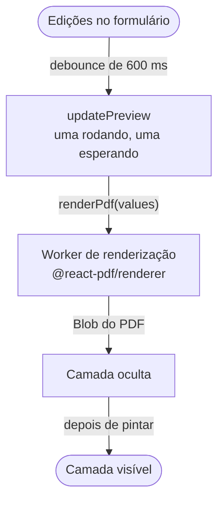

import { isBlogPostPublished } from "@web/lib/blog-publication";

O [post anterior](/pt-BR/blog/long-form-live-preview-tanstack-form) tratou de um formulário longo feito com TanStack Form. Esse formulário alimenta um preview de PDF ao lado dele. Cada edição re-renderiza um relatório de várias páginas, com gráficos e fotos, e o preview precisa acompanhar sem deixar a digitação no formulário lenta.

Duas bibliotecas com nomes confusos fazem o trabalho. A `@react-pdf/renderer` transforma componentes React em um arquivo PDF, e a `react-pdf` mostra esse arquivo usando o pdf.js.



## Por que a renderização precisa de uma thread própria

A `@react-pdf/renderer` faz o layout do documento e gera o PDF em JavaScript, numa única tarefa longa. Enquanto essa tarefa roda na thread principal, o navegador não consegue processar uma tecla nem pintar o caractere recém-digitado. Um preview que re-renderiza a cada edição coloca essa tarefa bem no meio da digitação.

Por isso a renderização roda num module worker. Medi um build de produção no Chrome headless num M1 Pro. O teste digita num campo de texto em oito sequências rápidas, com uma pausa depois de cada uma. O relatório tem dois layouts. Uma renderização leva cerca de 40 ms no worker com o layout mais simples e cerca de 130 ms com o mais denso. Durante a digitação, a thread principal não registra nenhuma tarefa longa, e o evento de input mais lento leva 24 ms.

## O worker de renderização

O worker renderiza os valores com `pdf(<Report values={values} />).toBlob()` e devolve `{ id, blob }`. Se a renderização lançar um erro, ele devolve `{ id, error }`, então um payload inválido rejeita só a própria promise. Na thread principal, a `renderPdf` transforma o worker numa função que retorna uma promise:

```ts
let worker: Worker | null = null;
let nextId = 0;
const pending = new Map<
  number,
  { resolve: (blob: Blob) => void; reject: (error: Error) => void }
>();
let lastRender: { values: FormValues; blob: Promise<Blob> } | null = null;

function getWorker(): Worker {
  if (worker) return worker;
  worker = new Worker(new URL("./pdf-worker.tsx", import.meta.url), { type: "module" });
  worker.onmessage = ({ data }) => {
    const request = pending.get(data.id);
    pending.delete(data.id);
    if (data.error) request?.reject(new Error(data.error));
    else request?.resolve(data.blob);
  };
  worker.onerror = () => {
    worker?.terminate();
    worker = null;
    for (const request of pending.values()) request.reject(new Error("PDF worker crashed"));
    pending.clear();
  };
  return worker;
}

export function renderPdf(values: FormValues): Promise<Blob> {
  if (lastRender?.values === values) return lastRender.blob;

  const blob = new Promise<Blob>((resolve, reject) => {
    const id = nextId++;
    pending.set(id, { resolve, reject });
    getWorker().postMessage({ id, values });
  });
  lastRender = { values, blob };
  blob.catch(() => {
    if (lastRender?.blob === blob) lastRender = null;
  });
  return blob;
}
```

Cada requisição espera em `pending` até chegar uma resposta com o id dela. Um worker que caiu nunca vai responder a essas requisições, então o `onerror` rejeita todas e descarta o worker. A próxima chamada cria um novo.

A primeira linha da `renderPdf` reaproveita a última renderização. Comparar por referência basta, porque o preview só recebe um objeto de snapshot novo quando o formulário muda. Baixar o PDF que o preview mostra passa o mesmo objeto e recebe a mesma promise. O app guarda uma entrada por layout, então trocar de layout e voltar também não renderiza de novo.

## Renderizando menos vezes

Um worker muda o trabalho de lugar, mas não o diminui. Se as edições chegassem mais rápido do que as renderizações terminassem, o preview ficaria mais atrasado a cada tecla digitada.

Dois limites mantêm a fila curta. O primeiro é um debounce de 600 ms (`PREVIEW_DEBOUNCE_MS`). A rota assina o store do formulário, e cada mudança reinicia o timer. Quando ele dispara, a rota copia os valores do formulário para o snapshot que o preview lê. O componente do formulário fica dentro de um `memo`, então essa atualização re-renderiza o preview e não toca no formulário. Escolhi os 600 ms no olho, longo o bastante para o preview não renderizar no meio de uma palavra.

A pausa também decide quando a thread principal paga o custo de carregar e pintar a página nova. Com a thread principal 4× mais lenta no DevTools, o layout mais denso deixa uma tarefa de cerca de 100 ms por renderização. Ela cai depois do debounce, quando a digitação já parou, então os eventos de input continuam levando no máximo 32 ms.

O segundo limite fica no hook do preview. Só uma renderização roda por vez, e um único slot guarda a próxima requisição:

```ts
const rendering = useRef(false);
const waiting = useRef<FormValues | null>(null);

async function updatePreview(values: FormValues) {
  waiting.current = values;
  if (rendering.current) return;

  rendering.current = true;
  while (waiting.current) {
    const next = waiting.current;
    waiting.current = null;
    try {
      showPdf(await renderPdf(next));
    } catch (error) {
      showError(error);
    }
  }
  rendering.current = false;
}
```

As chamadas que chegam durante uma renderização sobrescrevem o `waiting`. Assim o loop sempre pega o snapshot mais recente e pula os intermediários.

## Trocando de página sem frame em branco

Cada PDF novo ganha uma blob URL nova. Passar essa URL direto para o `<Document>` da `react-pdf` faz o componente recarregar, e a página fica em branco até o pdf.js pintá-la de novo.

Em vez disso, o preview mantém duas camadas, `shownPage` e `nextPage`. Cada camada é uma página de um PDF numa escala. A próxima camada renderiza oculta e só assume o lugar depois que o pdf.js termina de pintar o canvas dela:

```tsx
const promote = (layer: PageLayer) =>
  setPages((current) =>
    current.nextPage === layer ? { shownPage: layer, nextPage: null } : current,
  );

return [shownPage, nextPage].map(
  (layer) =>
    layer && (
      <Document key={layer.key} file={layer.url} options={pdfOptions}>
        <Page
          pageNumber={layer.page}
          scale={layer.scale}
          className={layer === shownPage ? "page" : "page hidden"}
          onRenderSuccess={layer === nextPage ? () => promote(layer) : undefined}
        />
      </Document>
    ),
);
```

A verificação `current.nextPage === layer` impede que uma renderização antiga vença. Se um PDF mais novo já substituiu a camada em espera, a renderização antiga termina e nada acontece. A camada promovida mantém a `key`, então o React reaproveita o mesmo canvas e só troca a classe.

Por padrão a `react-pdf` cria um worker do pdf.js para cada `<Document>`, o que custa cerca de 120 ms por atualização. O `pdfOptions` guarda um único `PDFWorker`, criado quando o módulo carrega e compartilhado por todos os documentos. Abrir um PDF nele leva cerca de 3 ms.

Antes de renderizar, o worker reduz cada foto para o dobro de `MAX_PHOTO_SIZE` com um `OffscreenCanvas`. Esse é o maior quadro de foto que qualquer layout desenha. O relatório que medi fica entre 220 e 250 KB, dependendo do layout.

## Takumi como renderizador alternativo

O [Takumi](https://takumi.kane.tw) renderiza JSX para PDF em WebAssembly e roda num Web Worker. Só que ele é mais pesado e não é mais rápido. Num benchmark separado no navegador, com os dois lado a lado, o Takumi num worker levou 55 ms por edição e baixou cerca de 1,45 MB. A maior parte disso é o motor em WebAssembly. A `@react-pdf/renderer` levou 40 ms e baixou 382 KB, mesmo rodando na thread principal. Quando a `@react-pdf/renderer` também roda num worker, o Takumi fica sem nenhuma vantagem clara.

{isBlogPostPublished(new Date("2026-11-28")) && (

  <p>
    O próximo post mostra como o mesmo app ganha{" "}
    <a href="/pt-BR/blog/pull-request-previews-with-alchemy">um preview na Cloudflare para cada pull request</a>.
  </p>
)}
