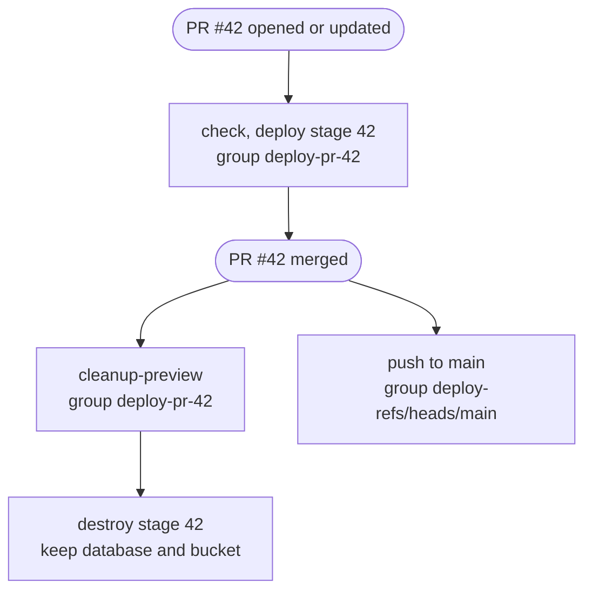

I [moved this site off Cloudflare](/blog/rewriting-my-portfolio-for-self-hosting) to self-hosting, but I still run other apps on Cloudflare with [Alchemy](https://alchemy.run/). One of them is the app behind my last two posts, [a long form with a live preview, on TanStack Form](/blog/long-form-live-preview-tanstack-form) and [a live PDF preview off the main thread](/blog/pdf-preview-in-a-web-worker). It's a small app on Workers with D1 and R2. It has production, a release rehearsal called `next`, a preview for every open pull request, and a local dev setup. One TypeScript file describes all of them.

## One script, one stage per run

Alchemy is infrastructure as code without a config language. `alchemy.run.ts` is a plain script, and each resource is an awaited function call. `D1Database("db", { ... })` creates the database on the first run and updates it on later runs. `alchemy deploy` runs the script. A state store records what each resource produced, and `app.finalize()` at the end deletes anything in the state that the script no longer declares.

Every run belongs to one stage, and each stage has its own state. A trimmed version of the script:

```ts
import alchemy from "alchemy";
import { D1Database, R2Bucket, TanStackStart } from "alchemy/cloudflare";
import { CloudflareStateStore } from "alchemy/state";

// No default stage, so a bare deploy or destroy fails here.
const stage = process.env.STAGE || process.env.PULL_REQUEST;
if (!stage) {
  throw new Error("Set STAGE (prod, next) or PULL_REQUEST (a PR number, or dev).");
}

const app = await alchemy("app", {
  stage,
  // The dev stage keeps its state in local files.
  stateStore:
    stage === "dev" ? undefined : (scope) => new CloudflareStateStore(scope, { forceUpdate: true }),
  password: process.env.ALCHEMY_SECRET,
});

const suffix = stage === "prod" ? "" : stage === "next" ? "-next" : "-dev";

const db = await D1Database("db", {
  name: `app-db${suffix}`,
  migrationsDir: "./migrations",
  adopt: true,
  delete: false,
});

const uploads = await R2Bucket("uploads", {
  name: `app-uploads${suffix}`,
  adopt: true,
  delete: false,
});

await TanStackStart("site", {
  domains:
    stage === "prod"
      ? ["app.example.com"]
      : stage === "next"
        ? ["next.app.example.com"]
        : undefined,
  bindings: { DB: db, UPLOADS: uploads },
});

await app.finalize();
```

The stage picks names in two ways. When I don't pass a name, Alchemy builds one from the app name, the resource ID and the stage, so the Worker is `app-site-prod`, `app-site-next` or `app-site-42`. The database and the bucket get explicit names through `suffix`, and every stage other than `prod` and `next` shares the `-dev` ones. `adopt: true` lets a new preview take over the existing `-dev` database and bucket instead of failing because the name is taken. The custom domains branch on `stage` too. A preview has none, so it runs on its `workers.dev` URL, and a `GitHubComment` resource posts that URL on the pull request.

Pushes to `main` and `next` deploy `prod` and `next`, a pull request deploys a stage named after its number, and the local dev script sets `PULL_REQUEST=dev`.

Sharing `-dev` means a new preview starts with data in it. It also means a migration in one pull request runs against the database that every other preview reads. With one developer, I accept that.

## Three safety rails

The script has no default stage. Deploy and destroy both run it first, so neither one can fall back to a stage I didn't name.

With `delete: false`, destroy removes `db` and `uploads` from the stage's state and leaves them in the account. Previews share the `-dev` names, so without the flag the first closed pull request would delete the database the other previews still use. For `prod` and `next`, it means destroying a stage never deletes its data.

The third rail is the upload token. The browser uploads images straight to R2 with presigned URLs, and the Worker signs them with an `AccountApiToken` that Alchemy creates per stage. The token has one policy, `Workers R2 Storage Bucket Item Write`, on one resource, `com.cloudflare.edge.r2.bucket.<account>_default_<bucket>`, built from the stage's bucket name. A preview can sign uploads into the `-dev` bucket and nowhere else.

## The pull request lifecycle

The workflow has three jobs. `deploy` skips pull requests from the `next` branch, because pushes to `next` already deploy that stage. `cleanup-preview` runs only on `closed` and calls `alchemy destroy` with the same `PULL_REQUEST` number. Trimmed to triggers, conditions and concurrency:

```yaml
on:
  push:
    branches: [main, next]
  pull_request:
    types: [opened, reopened, synchronize, closed]

concurrency:
  group: deploy-${{ github.event.pull_request.number && format('pr-{0}', github.event.pull_request.number) || github.ref }}
  cancel-in-progress: false

env:
  STAGE: ${{ github.event_name == 'push' && (github.ref_name == 'next' && 'next' || 'prod') || '' }}
  PULL_REQUEST: ${{ github.event.pull_request.number }}
  # Cloudflare, Alchemy and GitHub tokens go here too.

jobs:
  check:
    if: github.event.action != 'closed'
    runs-on: ubuntu-latest
    steps:
      - uses: actions/checkout@v6
      - run: npm ci
      - run: npm test

  deploy:
    needs: check
    if: github.event.action != 'closed' && github.head_ref != 'next'
    runs-on: ubuntu-latest
    steps:
      - uses: actions/checkout@v6
      - run: npm ci
      - run: npx alchemy deploy

  cleanup-preview:
    if: github.event.action == 'closed'
    runs-on: ubuntu-latest
    steps:
      - uses: actions/checkout@v6
      - run: npm ci
      - run: npx alchemy destroy
```

One caveat: in Alchemy 0.94, `alchemy destroy` exits with code 0 even when the destroy fails, so a failed cleanup still shows a green job. Leftover preview Workers only show up in the Cloudflare dashboard.



A concurrency group holds one running run and one pending run. When a third run joins, GitHub cancels the pending one, even with `cancel-in-progress: false`. The group key decides which runs can cancel each other. Pushes group by branch, and pull request runs group by number.

Grouping pull requests by `github.ref` looks equivalent, since a pull request's ref is `refs/pull/42/merge`. But when a merged pull request closes, `github.ref` is the base branch. The cleanup run would join `deploy-refs/heads/main`, the same group as the production deploy the merge starts. If another merge landed while production was still deploying, its run would replace the pending cleanup. With `pr-42` as the key, the cleanup waits only behind runs from its own pull request.

## What it costs

`CloudflareStateStore` keeps state in a Worker named `alchemy-state-service` in the same account, and `forceUpdate: true` uploads that Worker again on every run. CI needs an extra token for it. The state also holds each stage's secrets, encrypted with `ALCHEMY_SECRET`, so the cleanup job needs that password and the Cloudflare credentials just to delete a preview.

The 0.x releases now live in a separate [`alchemy-async`](https://github.com/alchemy-run/alchemy-async) repository, and nothing has shipped there since 0.94.0 on August 1, 2026. The main repository has moved to Alchemy v2, a rewrite on [Effect](https://effect.website/), and npm's `latest` tag points to a v2 beta. This app pins `alchemy` to exactly `0.94.0`.
