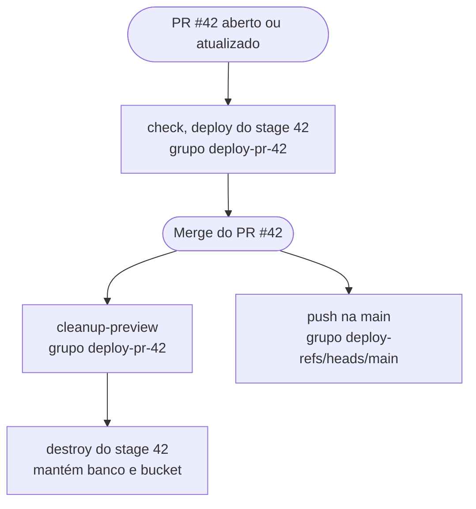

Eu [tirei este site da Cloudflare](/pt-BR/blog/rewriting-my-portfolio-for-self-hosting) e passei a hospedá-lo por conta própria, mas continuo rodando outros apps na Cloudflare com o [Alchemy](https://alchemy.run/). Um deles é o app dos meus dois últimos posts, [um formulário longo com preview ao vivo, no TanStack Form](/pt-BR/blog/long-form-live-preview-tanstack-form) e [um preview de PDF ao vivo fora da thread principal](/pt-BR/blog/pdf-preview-in-a-web-worker). É um app pequeno em Workers com D1 e R2. Ele tem produção, um ambiente de homologação chamado `next`, um preview para cada pull request aberto e um ambiente de desenvolvimento local. Um único arquivo TypeScript descreve todos eles.

## Um script, um stage por execução

O Alchemy é infraestrutura como código sem linguagem de configuração. O `alchemy.run.ts` é um script comum, e cada recurso é uma chamada de função com `await`. O `D1Database("db", { ... })` cria o banco na primeira execução e o atualiza nas seguintes. O `alchemy deploy` executa o script. Um state store registra o que cada recurso produziu, e o `app.finalize()` no final apaga tudo o que está no estado mas o script não declara mais.

Cada execução pertence a um stage, e cada stage tem o próprio estado. Uma versão enxuta do script:

```ts
import alchemy from "alchemy";
import { D1Database, R2Bucket, TanStackStart } from "alchemy/cloudflare";
import { CloudflareStateStore } from "alchemy/state";

// No default stage, so a bare deploy or destroy fails here.
const stage = process.env.STAGE || process.env.PULL_REQUEST;
if (!stage) {
  throw new Error("Set STAGE (prod, next) or PULL_REQUEST (a PR number, or dev).");
}

const app = await alchemy("app", {
  stage,
  // The dev stage keeps its state in local files.
  stateStore:
    stage === "dev" ? undefined : (scope) => new CloudflareStateStore(scope, { forceUpdate: true }),
  password: process.env.ALCHEMY_SECRET,
});

const suffix = stage === "prod" ? "" : stage === "next" ? "-next" : "-dev";

const db = await D1Database("db", {
  name: `app-db${suffix}`,
  migrationsDir: "./migrations",
  adopt: true,
  delete: false,
});

const uploads = await R2Bucket("uploads", {
  name: `app-uploads${suffix}`,
  adopt: true,
  delete: false,
});

await TanStackStart("site", {
  domains:
    stage === "prod"
      ? ["app.example.com"]
      : stage === "next"
        ? ["next.app.example.com"]
        : undefined,
  bindings: { DB: db, UPLOADS: uploads },
});

await app.finalize();
```

O stage define os nomes de duas formas. Quando não passo um nome, o Alchemy monta um a partir do nome do app, do ID do recurso e do stage, então o Worker vira `app-site-prod`, `app-site-next` ou `app-site-42`. O banco e o bucket recebem nomes explícitos pelo `suffix`, e todo stage além de `prod` e `next` compartilha os nomes `-dev`. O `adopt: true` faz um preview novo assumir o banco e o bucket `-dev` que já existem, em vez de falhar porque o nome está ocupado. Os domínios próprios também dependem do `stage`. Um preview não tem nenhum, então roda na própria URL `workers.dev`, e um recurso `GitHubComment` publica essa URL no pull request.

Os pushes na `main` e na `next` fazem deploy dos stages `prod` e `next`. Um pull request faz deploy de um stage com o número dele como nome, e o script de desenvolvimento local define `PULL_REQUEST=dev`.

Como o `-dev` é compartilhado, um preview novo já começa com dados. Por outro lado, uma migração de um pull request roda no banco que todos os outros previews leem. Como sou o único desenvolvedor, aceito isso.

## Três proteções

O script não tem stage padrão. O deploy e o destroy sempre começam por ele, então nenhum dos dois consegue cair num stage que eu não indiquei.

Com `delete: false`, o destroy tira o `db` e o `uploads` do estado do stage e os mantém na conta. Os previews compartilham os nomes `-dev`, então, sem a flag, o primeiro pull request fechado apagaria o banco que os outros previews ainda usam. Em `prod` e `next`, a flag garante que destruir um stage nunca apaga os dados dele.

A terceira proteção é o token de upload. O navegador envia as imagens direto para o R2 com URLs pré-assinadas, e o Worker assina essas URLs com um `AccountApiToken` que o Alchemy cria para cada stage. O token tem uma única política, `Workers R2 Storage Bucket Item Write`, sobre um único recurso, `com.cloudflare.edge.r2.bucket.<account>_default_<bucket>`, montado a partir do nome do bucket do stage. Um preview consegue assinar uploads para o bucket `-dev` e para nenhum outro.

## O ciclo de vida de um pull request

O workflow tem três jobs. O `deploy` ignora pull requests vindos da branch `next`, porque os pushes na `next` já fazem deploy desse stage. O `cleanup-preview` roda só no `closed` e chama `alchemy destroy` com o mesmo número em `PULL_REQUEST`. Reduzido aos gatilhos, às condições e à concorrência:

```yaml
on:
  push:
    branches: [main, next]
  pull_request:
    types: [opened, reopened, synchronize, closed]

concurrency:
  group: deploy-${{ github.event.pull_request.number && format('pr-{0}', github.event.pull_request.number) || github.ref }}
  cancel-in-progress: false

env:
  STAGE: ${{ github.event_name == 'push' && (github.ref_name == 'next' && 'next' || 'prod') || '' }}
  PULL_REQUEST: ${{ github.event.pull_request.number }}
  # Cloudflare, Alchemy and GitHub tokens go here too.

jobs:
  check:
    if: github.event.action != 'closed'
    runs-on: ubuntu-latest
    steps:
      - uses: actions/checkout@v6
      - run: npm ci
      - run: npm test

  deploy:
    needs: check
    if: github.event.action != 'closed' && github.head_ref != 'next'
    runs-on: ubuntu-latest
    steps:
      - uses: actions/checkout@v6
      - run: npm ci
      - run: npx alchemy deploy

  cleanup-preview:
    if: github.event.action == 'closed'
    runs-on: ubuntu-latest
    steps:
      - uses: actions/checkout@v6
      - run: npm ci
      - run: npx alchemy destroy
```

Uma ressalva: no Alchemy 0.94, o `alchemy destroy` sai com código 0 mesmo quando o destroy falha, então uma limpeza com falha continua aparecendo como job verde. Os Workers de preview que sobram só aparecem no painel da Cloudflare.



Um grupo de concorrência comporta uma execução em andamento e uma pendente. Quando uma terceira entra, o GitHub cancela a pendente, mesmo com `cancel-in-progress: false`. A chave do grupo decide quais execuções podem cancelar umas às outras. Os pushes se agrupam pela branch, e as execuções de pull request, pelo número.

Agrupar os pull requests por `github.ref` parece dar no mesmo, já que a ref de um pull request é `refs/pull/42/merge`. Só que, quando um pull request é fechado com merge, o `github.ref` passa a ser a branch base. A execução de limpeza entraria em `deploy-refs/heads/main`, o mesmo grupo do deploy de produção que o merge dispara. Se outro merge entrasse enquanto o deploy de produção ainda estivesse rodando, a execução dele substituiria a limpeza pendente. Com `pr-42` como chave, a limpeza só espera execuções do próprio pull request.

## Quanto custa

O `CloudflareStateStore` guarda o estado num Worker chamado `alchemy-state-service`, na mesma conta, e o `forceUpdate: true` reenvia esse Worker a cada execução. O CI precisa de um token a mais para ele. O estado também guarda os segredos de cada stage, criptografados com o `ALCHEMY_SECRET`, então o job de limpeza precisa dessa senha e das credenciais da Cloudflare só para apagar um preview.

As versões 0.x agora ficam num repositório separado, o [`alchemy-async`](https://github.com/alchemy-run/alchemy-async), e nenhuma versão saiu por lá desde a 0.94.0, em 1º de agosto de 2026. O repositório principal passou para o Alchemy v2, uma reescrita em cima do [Effect](https://effect.website/), e a tag `latest` do npm aponta para um beta da v2. Este app fixa a versão do `alchemy` em exatamente `0.94.0`.
